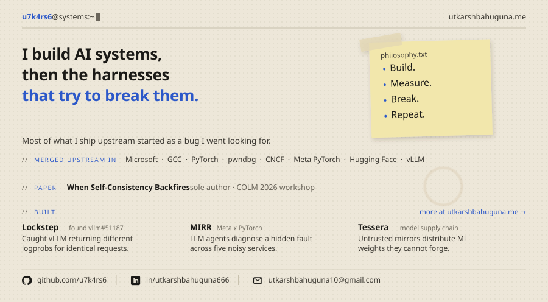

CS at <b>BITS Pilani</b>. I work on AI infrastructure and spend most of my time trying to break it. 
<b>83 PRs merged upstream</b>, 59 of them AI work, across 12 organisations including Microsoft, PyTorch, NVIDIA, Hugging Face and CNCF.

---

- **Nine of my patches are in GCC master**, carried up from the gccrs tree by the project's syncs to gcc-patches with authorship kept.
- **44 of those 83 fix bugs I found and reported myself**, not tickets off a board. One was in my own merged code.
- **I found nondeterminism in vLLM's deterministic mode** ([vllm#51187](https://github.com/vllm-project/vllm/issues/51187)): repeats match only if every token is reduced at the same RMSNorm block width.
- **Sole author of a COLM 2026 workshop paper.** [When Self-Consistency Backfires](https://arxiv.org/abs/2608.11403): majority voting *lowers* accuracy on 56–66% of GPQA Diamond problems.

### Open source

| Project | Merged |
| :-- | :-- |
| **[microsoft/PyRIT](https://github.com/microsoft/PyRIT/pulls?q=is%3Amerged+author%3Au7k4rs6)** | **40** · the CodeAttack converter, plus fixes to TAP/PAIR, scale scorers and dataset loaders |
| **[gccrs](https://github.com/Rust-GCC/gccrs/pulls?q=is%3Amerged+author%3Au7k4rs6)** · GCC Rust frontend | **15** · match arm guards, an exponential trait-probe fix that unblocked libcore type checking, nine patches now in GCC master |
| **[PyTorch](https://github.com/pytorch/torchtitan/pulls?q=is%3Amerged+author%3Au7k4rs6)** · executorch, torchtitan | **8** · Inspector crashes on non-finite output, wandb tag splitting, scheduler range checks |
| **[jaeger-ui](https://github.com/jaegertracing/jaeger-ui/pulls?q=is%3Amerged+author%3Au7k4rs6)** · CNCF | **4** · GenAI span classification, media rendering, RFC wire-format corrections |
| **[pwndbg](https://github.com/pwndbg/pwndbg/pulls?q=is%3Amerged+author%3Au7k4rs6)** · GDB exploit-dev frontend | **5** · a pointer-scan crash, its help text, negative-value searches |
| **[OpenEnv](https://github.com/openenv/OpenEnv/pulls?q=is%3Amerged+author%3Au7k4rs6)** · was Hugging Face | **2** · SSRF-safe URL parsing, Space subdomain resolution |
| **[meta-pytorch/tritonbench](https://github.com/meta-pytorch/tritonbench/pulls?q=is%3Amerged+author%3Au7k4rs6)** | **2** · child runs failing unless started one exact way, A/B metrics crash |
| **[NVIDIA/garak](https://github.com/NVIDIA/garak/pull/1842)** | **1** · fixed Bedrock scans that failed for every Claude 4.x user |
| **Also** | llm-compressor ×2, AI Village ×2, openkruise/agents, openyurtio/raven |

### Building

| | |
| :-- | :-- |
| **[Lockstep](https://github.com/u7k4rs6/LockStep)** | Verifies an inference engine returns the same tokens whatever else was batched. Caught vLLM 0.26.0 returning different logprobs for byte-identical requests ([vllm#51187](https://github.com/vllm-project/vllm/issues/51187)). |
| **[MIRR](https://github.com/u7k4rs6/MIRR)** | LLM agents diagnose a hidden fault across five noisy microservices under partial observability. Built for the Meta x PyTorch hackathon. |
| **[Tessera](https://github.com/u7k4rs6/Tessera)** | Verified-by-default distribution for ML models and datasets. Publishers sign once; untrusted mirrors can deny a model but cannot forge one. |
| **[Shadowbook](https://github.com/u7k4rs6/Shadowbook)** | A limit order book in Rust. 416ns p50 insert, 100M fuzzed ops against an oracle, zero divergences. |
| **[Flint](https://github.com/u7k4rs6/Flint)** | An x86-64 kernel in Rust. Ring 3 isolation proven by a breakout harness. |

More, including Thrice, Starling and CAIRN, at [utkarshbahuguna.me](https://utkarshbahuguna.me).

I publish what the measurements say. When all-pairs comparison showed half of a Lockstep finding was an artifact, the retraction went next to the result.

<code>Rust</code> <code>C++</code> <code>Python</code> <code>CUDA/Triton</code> <code>Go</code> <code>Java</code> <code>TypeScript</code>
  
<a href="https://utkarshbahuguna.me">Portfolio</a> &#160;&#183;&#160;
<a href="https://linkedin.com/in/utkarshbahuguna666">LinkedIn</a> &#160;&#183;&#160;
<a href="mailto:utkarshbahuguna10@gmail.com">Email</a>

